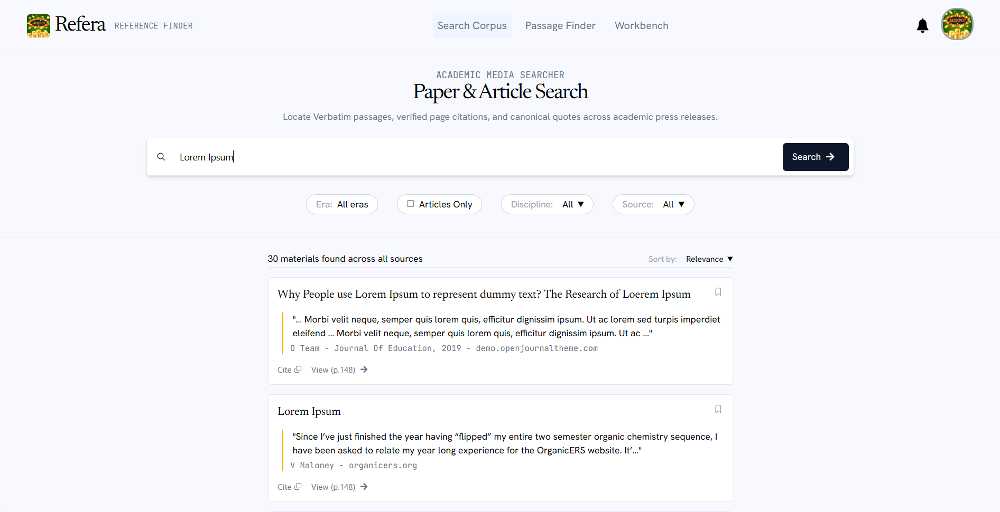

# Refera

Refera is a search tool that finds academic papers, articles and archive material across several platforms at once, so students and researchers don't have to search each one separately.




## Features

- **Multi-source search** across Google Scholar (via SerpApi), OpenAlex and the Digital Bodleian archive, from a single search box.
- **Unified results.** Each source has its own adapter that normalizes its response into one typed result shape (title, authors, snippet, year, citations, link).
- **Deduplication.** Results found on more than one source are merged, matching on DOI first and normalized title and year as a fallback.
- **Filters:**
  - **Era**, using a two-handle year slider with an "All Eras" option
  - **Discipline**, using OpenAlex's field classification
  - **Articles only**, restricting results to journal-style articles
- **Sorting** by relevance, most cited, or most recent.
- **Shared caching and rate limiting** to avoid repeat upstream calls and protect limited API quotas.
- **Partial-failure handling.** If one source is down or times out, you still get results from the others, with a message saying which one failed.

## Tech stack

| Layer | Tools |
| --- | --- |
| Frontend | React, TypeScript, Tailwind CSS |
| Backend | Node.js, Express, TypeScript |
| Data sources | SerpApi (Google Scholar), OpenAlex API, Digital Bodleian API |

## Project structure

```
refera/
├── backend/    # Express API: /search, /disciplines, source adapters, cache, dedupe
└── frontend/   # React app
```

## Getting started

### Prerequisites

- Node.js [version, e.g. 20 or later]
- A SerpApi key and an OpenAlex API key

### 1. Clone and install

```bash
git clone https://github.com/diremu/Refera.git
cd Refera

cd backend && npm install
cd ../frontend && npm install
```

### 2. Configure environment variables

Create `backend/.env`:

```env
PORT=3000
SERPAPI_KEY=your_serpapi_key
OPENALEX_KEY=your_openalex_key
OPENALEX_API=https://api.openalex.org
BODLEIAN_API=https://digital.bodleian.ox.ac.uk
SERPAPI_DAILY_CAP=50
```

Never commit `.env`. It should be listed in `.gitignore`. Use `.env.example` to show other developers which variables are needed.

### 3. Run it

```bash
# terminal 1
cd backend
npm run dev     # [replace with your actual script]

# terminal 2
cd frontend
npm run dev     # [replace with your actual script]
```

The frontend expects the API at `http://localhost:3000`.

## API

### `POST /search`

```json
{
  "searchStr": "great depression",
  "eraObject": { "yearStart": 1900, "yearEnd": 1950 },
  "prOnly": false,
  "discipline": "All",
  "source": "All"
}
```

Returns `{ results, errors }`, where `errors` lists any sources that failed, as `{ source, message }` entries.

### `GET /disciplines`

Returns the list of discipline names for the filter dropdown.

## Limitations

- **Discipline and article-type filters** only apply to OpenAlex. Google Scholar and Bodleian have no equivalent.
- **"Articles only"** filters by OpenAlex's article type. This approximates peer review but doesn't guarantee it.
- **Digital Bodleian** holds mostly historical manuscripts, prints and ephemera, so modern eras often return nothing from it.
- **Google Scholar results** come through SerpApi, which has a limited quota, so heavy use hits the daily cap.

## Roadmap

- [ ] Pagination across all sources
- [ ] Startup validation of required environment variables
- [ ] Tests for the adapters and deduplication

## Contributing

Refera is currently developed by [diremu](https://github.com/diremu). Contributions, bug reports and suggestions are welcome: open an issue to discuss a change, then submit a pull request.

## Acknowledgements

Data comes from [OpenAlex](https://openalex.org), [Google Scholar](https://scholar.google.com) through [SerpApi](https://serpapi.com), and [Digital Bodleian](https://digital.bodleian.ox.ac.uk). Please respect each provider's terms of use.